# Heart Disease Prediction Using Machine Learning

I made this project to get practical experience with the complete machine learning workflow, starting from exploring a dataset and handling missing values to training different models, comparing their performance, and understanding their predictions using SHAP.

I used the Cleveland heart disease dataset from the UCI Machine Learning Repository. Instead of relying on just one algorithm, I trained and compared five machine learning models to understand how their performance differs on the same dataset.

This is an educational machine learning project. The results are based on a relatively small dataset and should not be used to diagnose heart disease or make medical decisions.

## What I worked on

- Explored the dataset and checked its structure, data types, missing values, class distribution, and possible outliers.
- Prepared the data for machine learning, including handling missing values and encoding categorical features.
- Split the data into training and test sets while preserving the target-class distribution.
- Built preprocessing and modelling pipelines using scikit-learn.
- Compared five machine learning algorithms using stratified 5-fold cross-validation.
- Evaluated the models on a held-out test set.
- Used SHAP to investigate which features influenced the CatBoost model's predictions.
- Saved the trained pipelines, evaluation results, plots, and project screenshots.

## Dataset

**Source:** [UCI Machine Learning Repository — Heart Disease](https://archive.ics.uci.edu/dataset/45/heart+disease)

The project uses the processed Cleveland dataset, which contains 303 patient records and 14 columns, including the target variable.

The dataset includes patient information such as age and sex, resting blood pressure, cholesterol, maximum heart rate, exercise-induced angina, and other clinical measurements.

### Target preparation

The original target column has values from 0 to 4:

- `0` represents the absence of heart disease in this dataset.
- Values greater than `0` represent the presence of heart disease.

For this project, I converted the target into a binary classification problem:

| Original target | Model target | Meaning |
|---|---:|---|
| 0 | 0 | No heart disease indicated |
| 1–4 | 1 | Heart disease indicated |

After this conversion, the dataset contained:

| Class | Number of records |
|---|---:|
| Target 0 | 164 |
| Target 1 | 139 |
| **Total** | **303** |

The target classes are not perfectly balanced, so I used stratified splitting and stratified cross-validation to maintain a similar class distribution across the different subsets.

### Missing values and outliers

The initial data inspection identified missing values in two columns:

| Feature | Missing values |
|---|---:|
| `ca` | 4 |
| `thal` | 2 |

I also investigated possible outliers in cholesterol values using the interquartile range (IQR) method. Five observations were flagged for further inspection. I retained these observations rather than removing them automatically, because an unusual clinical measurement is not necessarily an invalid observation.

The missing values were handled during model preprocessing rather than by fitting the preprocessing steps on the entire dataset.

## Project workflow

### 1. Data exploration

I first inspected the dataset to understand its size, feature types, missing values, and target distribution.

I created visualisations to examine:

- Age distribution
- Target-class distribution
- Categorical feature distributions
- Cholesterol distribution and possible outliers
- Missing values and data types

These checks helped me understand the dataset before training any models.

### 2. Data preprocessing

I used a column-specific preprocessing pipeline:

| Feature type | Preprocessing |
|---|---|
| Numerical features | Median imputation and standardisation |
| Binary features | Most-frequent-value imputation |
| Categorical features | Most-frequent-value imputation and one-hot encoding |

I used `StandardScaler` for numerical features and `OneHotEncoder(handle_unknown="ignore")` for categorical features.

The preprocessing steps were included in scikit-learn pipelines. This is important because the imputers, scaler, and encoder are fitted on the training data within each cross-validation fold, rather than learning information from the validation or test data.

I split the data into 80% training data and 20% test data, using stratification and `random_state=42`.

| Subset | Records |
|---|---:|
| Training set | 242 |
| Test set | 61 |
| **Total** | **303** |

### 3. Model training and comparison

I compared five algorithms:

1. Logistic Regression
2. Random Forest
3. Support Vector Machine (SVM)
4. Multi-Layer Perceptron (MLP) Neural Network
5. CatBoost

I chose these models to compare different approaches to classification, including a linear model, tree-based models, a margin-based model, and a neural network.

I used stratified 5-fold cross-validation on the training set. The training data was divided into five folds, with each fold serving as the validation fold once.

I recorded accuracy, precision, recall, F1-score, and ROC-AUC. I used the mean and standard deviation across the five folds to examine both performance and variation between folds.

### 4. Cross-validation results

The following are the actual mean scores obtained during the cross-validation run.

| Model | Accuracy (mean) | Precision (mean) | Recall (mean) | F1-score (mean) | ROC-AUC (mean) |
|---|---:|---:|---:|---:|---:|
| Logistic Regression | 0.8471 | 0.8768 | 0.7834 | 0.8245 | 0.9039 |
| SVM | 0.8263 | 0.8396 | 0.7830 | 0.8049 | 0.8843 |
| Random Forest | 0.8099 | 0.8106 | 0.7739 | 0.7879 | 0.8939 |
| CatBoost | 0.7974 | 0.7943 | 0.7648 | 0.7751 | 0.8878 |
| MLP Neural Network | 0.7642 | 0.7508 | 0.7470 | 0.7438 | 0.8360 |

*Note: The values are rounded to four decimal places. The model ranking depends on the metric being considered.*

Logistic Regression achieved the highest mean ROC-AUC in this cross-validation comparison, at 0.9039. It also achieved the highest mean accuracy and F1-score among these five models in this run.

One thing I learned from this comparison is that a more complex model does not automatically perform better. Logistic Regression performed well on this dataset despite being a relatively simple model.

### 5. Held-out test-set evaluation

After the cross-validation comparison, I evaluated the models on the held-out test set containing 61 records.

| Model | Accuracy | Precision | Recall | F1-score | ROC-AUC |
|---|---:|---:|---:|---:|---:|
| Logistic Regression | 0.8852 | 0.8387 | 0.9286 | 0.8814 | 0.9675 |
| SVM | 0.8852 | 0.8387 | 0.9286 | 0.8814 | 0.9621 |
| MLP Neural Network | 0.8689 | 0.8125 | 0.9286 | 0.8667 | 0.9600 |
| CatBoost | 0.9016 | 0.8438 | 0.9643 | 0.9000 | 0.9578 |
| Random Forest | 0.9016 | 0.8438 | 0.9643 | 0.9000 | 0.9481 |

On this test set, Random Forest and CatBoost achieved the highest accuracy, at approximately 90.16%, and the highest F1-score, at 0.9000.

Logistic Regression achieved the highest test ROC-AUC, at 0.9675.

These results do not establish one universally best model. The models were evaluated on only 61 test records, so a small number of different predictions could change the reported scores. The test results should also be interpreted alongside the cross-validation results rather than in isolation.

For this project, I kept the model comparison and explainability analysis as separate tasks: I used the cross-validation results to understand the models' comparative performance, and I used CatBoost as the example model for the SHAP analysis.

## SHAP explainability

After training the CatBoost pipeline, I used SHAP (SHapley Additive exPlanations) to examine how the model's features contributed to its predictions.

I calculated mean absolute SHAP values for the transformed test-set features and used them to rank the features by their average contribution magnitude.

The top ten features in the resulting analysis were:

| Rank | Feature | Mean absolute SHAP value |
|---:|---|---:|
| 1 | `categorical__ca_0.0` | 0.7240 |
| 2 | `categorical__cp_4.0` | 0.5831 |
| 3 | `categorical__thal_3.0` | 0.4626 |
| 4 | `categorical__thal_7.0` | 0.4193 |
| 5 | `numeric__oldpeak` | 0.4121 |
| 6 | `binary__sex` | 0.3422 |
| 7 | `numeric__thalach` | 0.2682 |
| 8 | `numeric__age` | 0.2092 |
| 9 | `binary__exang` | 0.1922 |
| 10 | `numeric__chol` | 0.1674 |

Some categorical variables appear as separate entries because one-hot encoding creates a separate feature for each category. For example, `categorical__cp_4.0` represents one encoded category of the original `cp` feature.

Mean absolute SHAP values indicate the average magnitude of a feature's contribution to the model output. They do not, on their own, show whether a feature increases or decreases a prediction, establish causation, or prove clinical importance.

The SHAP results help explain what the trained model relied on in this dataset. They should not be interpreted as evidence that the same feature ranking would apply to other patient populations.

## Screenshots and Results

I saved screenshots during the different stages of the project to show the data exploration, preprocessing, model evaluation, and SHAP analysis.

### 1. Data Exploration

**Dataset inspection**

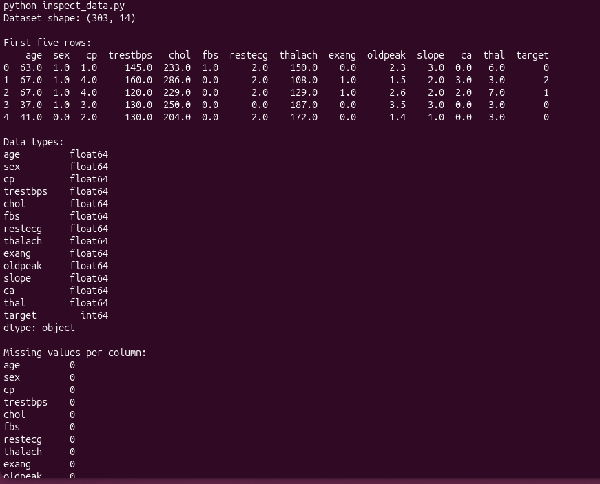

**Missing values and data types**

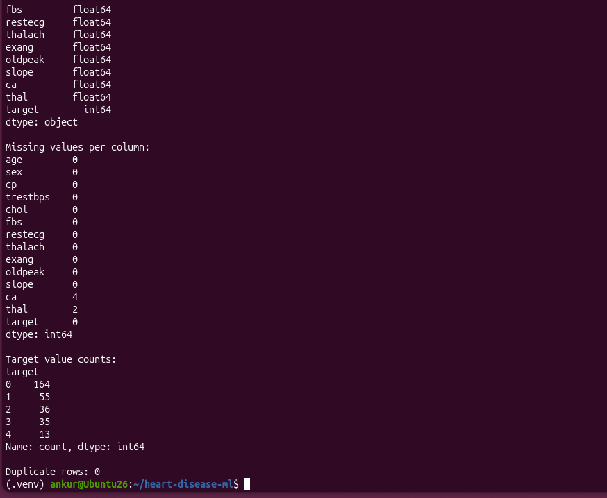

**Target distribution**

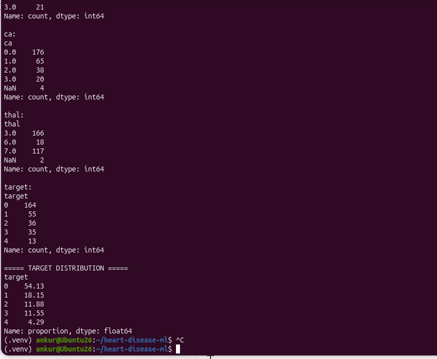

**Age distribution**

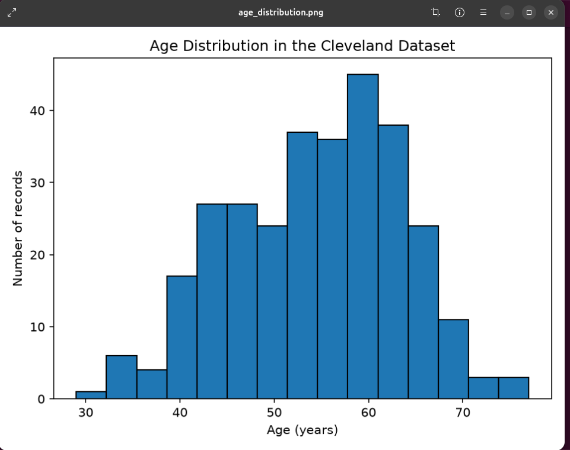

**Categorical feature distributions**

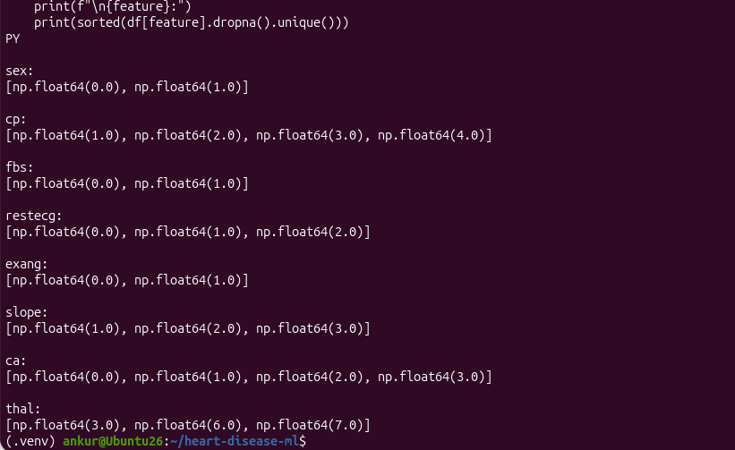

**Cholesterol distribution**

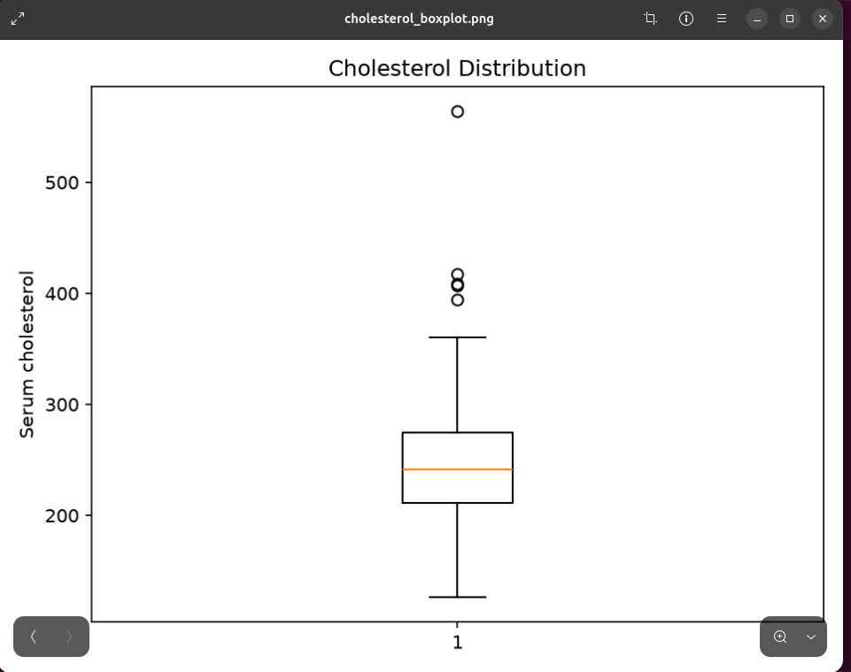

**Outlier analysis**

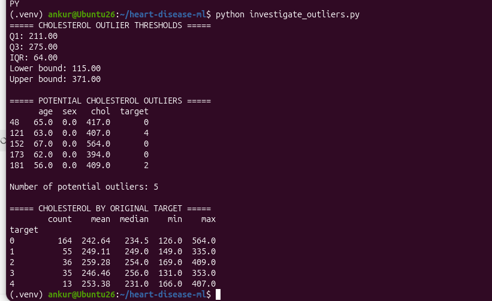

**Additional data exploration**

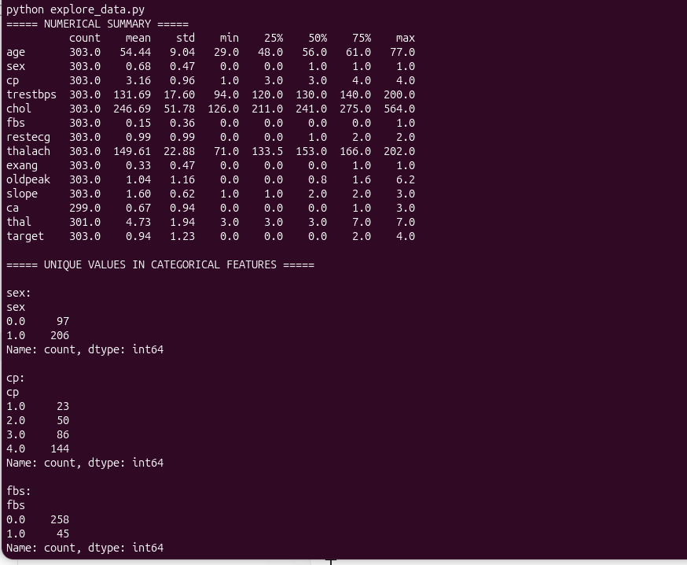

### 2. Preprocessing and Model Training

**Preprocessing pipeline**

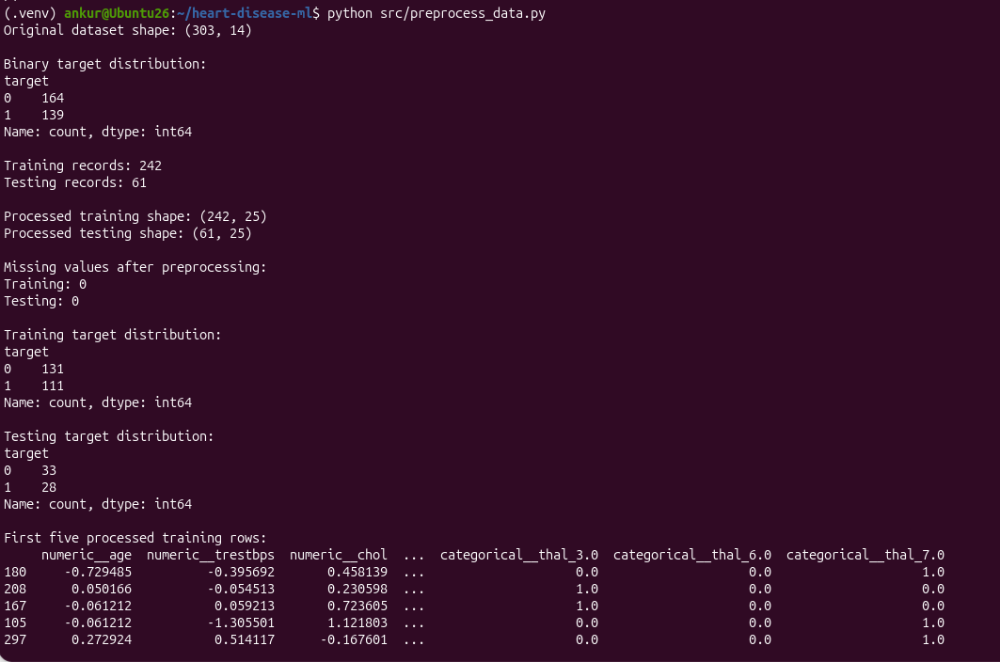

**Logistic Regression baseline**

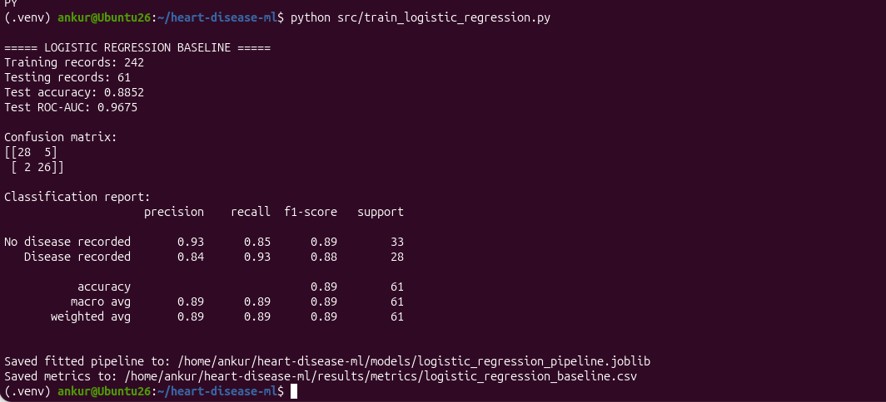

### 3. Model Evaluation

**Cross-validation results**

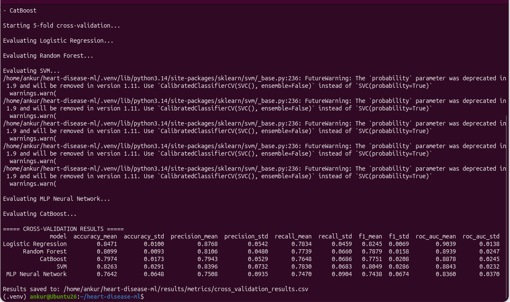

**Held-out test-set results**

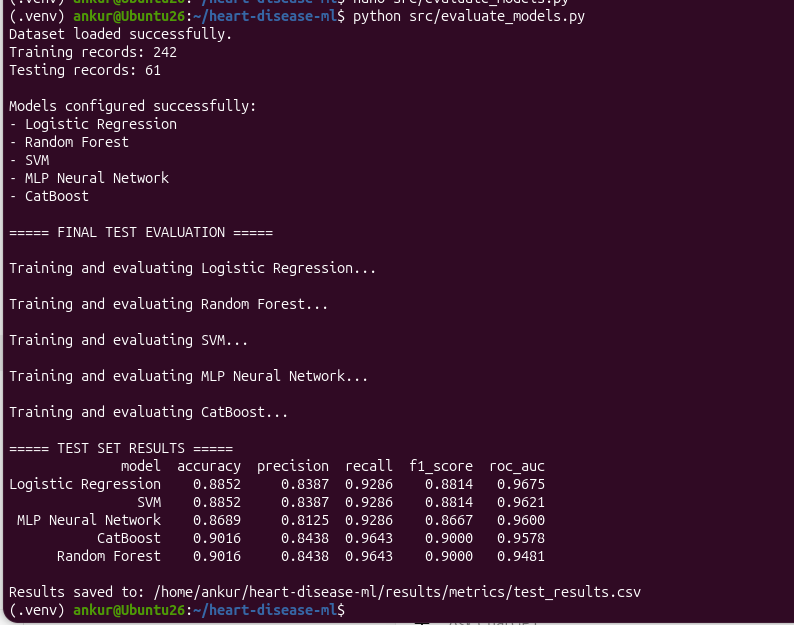

### 4. Model Explainability Using SHAP

I used SHAP to examine the features that contributed most to the CatBoost model's predictions.

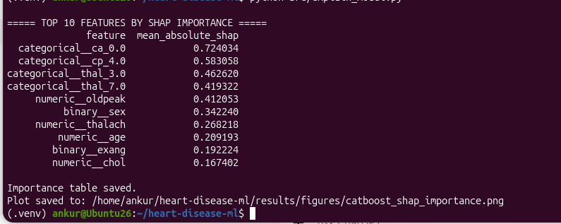

The generated feature-importance plot is also available here:

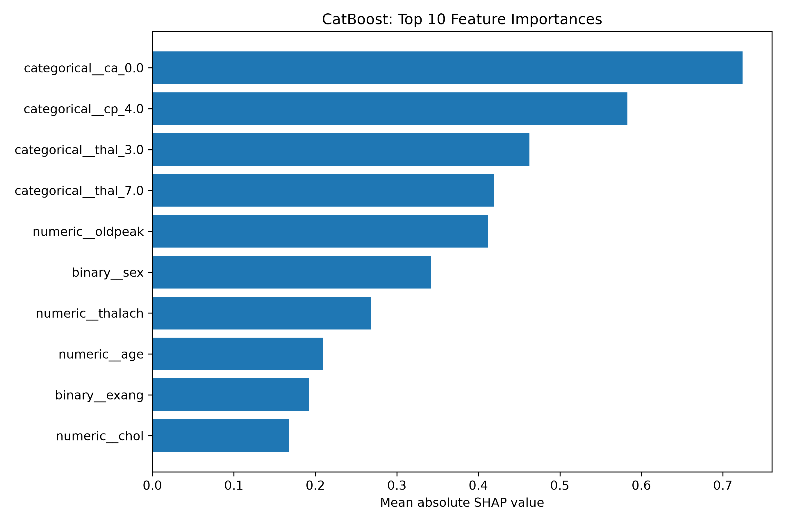
## Project structure

```text
heart-disease-ml/
├── data/
│   ├── raw/
│   │   └── processed.cleveland.data
│   └── processed/                 # Generated files; excluded from Git
├── docs/
│   └── screenshots/
│       ├── data_exploration/
│       ├── model_evaluation/
│       ├── model_training/
│       ├── preprocessing/
│       └── shap_analysis/
├── models/
│   ├── catboost_pipeline.joblib
│   └── logistic_regression_pipeline.joblib
├── results/
│   ├── figures/
│   │   └── catboost_shap_importance.png
│   └── metrics/
│       ├── catboost_shap_importance.csv
│       ├── cross_validation_results.csv
│       ├── logistic_regression_baseline.csv
│       └── test_results.csv
├── src/
│   ├── compare_models.py
│   ├── evaluate_models.py
│   ├── explain_model.py
│   ├── preprocess_data.py
│   └── train_logistic_regression.py
├── explore_data.py
├── inspect_data.py
├── investigate_outliers.py
├── visualize_data.py
├── requirements.txt
└── README.md
```

The `data/processed/` directory contains intermediate files generated during preprocessing. These files are excluded from version control. The raw dataset, source scripts, saved model pipelines, evaluation outputs, and screenshots are included in the repository.

## Tools and libraries

- **Python** — main programming language
- **Pandas and NumPy** — data handling and numerical operations
- **Matplotlib and Seaborn** — data visualisation
- **Scikit-learn** — preprocessing, pipelines, model training, cross-validation, and evaluation
- **CatBoost** — gradient-boosting classifier
- **SHAP** — model explainability
- **Joblib** — saving trained model pipelines
- **Git and GitHub** — version control and project sharing

## How to run the project

The commands below assume that Python and Git are installed and that the repository has been cloned.

### 1. Clone the repository

```bash
git clone https://github.com/ANKUR77019/heart-disease-ml.git
cd heart-disease-ml
```

### 2. Create and activate a virtual environment

On Ubuntu or another Linux system:

```bash
python3 -m venv .venv
source .venv/bin/activate
```

### 3. Install the dependencies

```bash
python -m pip install --upgrade pip
pip install -r requirements.txt
```

### 4. Run the analysis scripts

Start with data exploration:

```bash
python inspect_data.py
python explore_data.py
python investigate_outliers.py
python visualize_data.py
```

Then run preprocessing:

```bash
python src/preprocess_data.py
```

Run the model comparison:

```bash
python src/compare_models.py
```

Evaluate the models on the held-out test set:

```bash
python src/evaluate_models.py
```

Run the CatBoost SHAP analysis:

```bash
python src/explain_model.py
```

The scripts save intermediate data, model files, metrics, and figures in the project directories. The exact outputs depend on the script configuration and the installed package versions.

**Reproducibility note:** The project uses `random_state=42` for the data split, but exact results can still vary with package versions, implementation details, or changes to the code. The reported tables above are the results from the recorded project runs.

## Limitations

There are several important limitations to this project:

- The dataset contains only 303 records, and the held-out test set contains 61 records.
- The data comes from the Cleveland subset of a historical heart disease dataset. It does not represent every population or clinical setting.
- The binary target combines original target values 1–4 into a single positive class, losing the original distinction between disease categories.
- Cross-validation and test-set results are estimates from this dataset, not evidence of clinical validity.
- SHAP explains the behaviour of the fitted model; it does not establish causal relationships.
- The model has not been validated prospectively or tested for use in clinical practice.

For these reasons, this project is intended for learning and demonstrating a machine learning workflow, not for medical diagnosis or treatment decisions.

## What I learned

Working through this project helped me connect several steps that are often studied separately: data exploration, preprocessing, model training, cross-validation, test-set evaluation, and explainability.

Comparing five models also showed me why it is important to look at multiple metrics instead of relying only on accuracy. The cross-validation results and test-set results did not produce exactly the same ranking, which is a useful reminder that model performance estimates can change with the data used for evaluation.

I also gained practical experience with scikit-learn pipelines, handling missing values, encoding categorical variables, saving trained models, and using SHAP to inspect model predictions.

## Repository

**GitHub:** https://github.com/ANKUR77019/heart-disease-ml

## Acknowledgement

The dataset used in this project is from the [UCI Machine Learning Repository's Heart Disease dataset](https://archive.ics.uci.edu/dataset/45/heart+disease). Please refer to the original dataset page for its background, documentation, and usage information.
